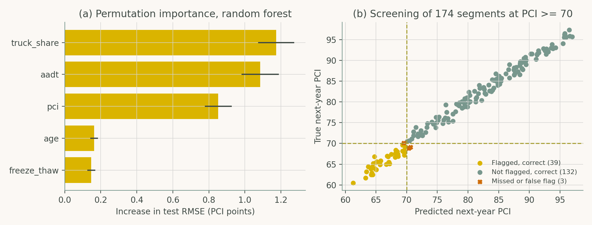
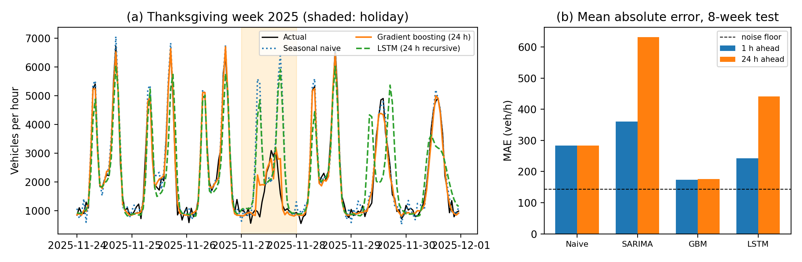

# Artificial Intelligence in Highway Engineering

Companion code for **Artificial Intelligence in Highway Engineering** by Subasish Das.

**Website: <https://ai-in-transportation-lab.github.io/ai-in-he/>**: browse every script with its figure and a download link.

Every code listing in the book's case studies is here as a runnable Python script, organised by chapter. The scripts generate their own synthetic data, so you can reproduce each figure and printed result with no data access agreements. Chapter 4, Case Study 2 downloads one small model and one image.

<p align="center">
  
  
  
</p>

## Contents

Chapter 1 is conceptual and has no code listings. Chapters 2 to 8 each have two case studies.

| Ch. | Title | Case studies |
|---|---|---|
| 2 | [AI Core Concepts and Methodologies](chapters/ch02_core_concepts/) | [CS1](chapters/ch02_core_concepts/cs1_mlp_traffic_volume.py) A neural network for hourly traffic volume · [CS2](chapters/ch02_core_concepts/cs2_gnn_local_volume.py) A graph neural network for volume on uncounted local roads |
| 3 | [AI for Traffic Flow, Congestion, and Road Safety](chapters/ch03_traffic_flow_and_safety/) | [CS1](chapters/ch03_traffic_flow_and_safety/cs1_volume_forecasting.py) Short-term traffic volume forecasting · [CS2](chapters/ch03_traffic_flow_and_safety/cs2_crash_risk_classification.py) Real-time crash risk classification |
| 4 | [AI for Connected and Automated Vehicles](chapters/ch04_connected_automated_vehicles/) | [CS1](chapters/ch04_connected_automated_vehicles/cs1_synthetic_perception_dataset.py) A synthetic, automatically labeled perception dataset · [CS2](chapters/ch04_connected_automated_vehicles/cs2_onnx_detector_robustness.py) Edge object detection and robustness testing |
| 5 | [AI in Public Transportation and Mobility Services](chapters/ch05_public_transportation/) | [CS1](chapters/ch05_public_transportation/cs1_grade_crossing_simulation.py) Discrete-event simulation of a grade crossing · [CS2](chapters/ch05_public_transportation/cs2_fare_engine.py) An account-based fare engine prototype |
| 6 | [AI for Transportation Infrastructure Management](chapters/ch06_infrastructure_management/) | [CS1](chapters/ch06_infrastructure_management/cs1_pavement_screening.py) Pavement deterioration and treatment screening · [CS2](chapters/ch06_infrastructure_management/cs2_pavement_digital_twin.py) Maintenance-trigger policies in a pavement digital twin |
| 7 | [AI-Powered Data Analytics and Decision Support](chapters/ch07_analytics_decision_support/) | [CS1](chapters/ch07_analytics_decision_support/cs1_exposure_adjusted_crashes.py) Exposure-adjusted crash analysis · [CS2](chapters/ch07_analytics_decision_support/cs2_crash_narrative_screening.py) Evidence screening in crash narratives |
| 8 | [Emerging AI Models and Future Horizons in Highway Engineering](chapters/ch08_emerging_models/) | [CS1](chapters/ch08_emerging_models/cs1_q_learning_signal_control.py) Learning a signal control policy from experience · [CS2](chapters/ch08_emerging_models/cs2_charger_qubo.py) Formulating charger siting as a QUBO |

Each chapter folder has its own README with the problem statement, libraries used and the figure the script reproduces.

## A taste of the code

Simulated annealing for charger siting (Chapter 8, Case Study 2). The full scripts are on the [website](https://ai-in-transportation-lab.github.io/ai-in-he/chapters/) and in [`chapters/`](chapters/).

```python
def anneal(Q, c, sweeps=3000, T0=50.0, T1=0.05, seed=0):
    r = np.random.default_rng(seed)
    x = r.integers(0, 2, len(Q)).astype(float)
    e = energy(x, Q, c)
    for s in range(sweeps):
        T = T0 * (T1 / T0) ** (s / sweeps)
        i = r.integers(len(Q))
        x[i] = 1 - x[i]
        e_new = energy(x, Q, c)
        if e_new <= e or r.random() < np.exp(-(e_new - e) / T):
            e = e_new
        else:
            x[i] = 1 - x[i]
    return e, x
```

## Quick start

You need Python 3.11 or 3.12 (TensorFlow does not yet support newer versions). [uv](https://docs.astral.sh/uv/) is the easiest way to get a matching environment:

```bash
git clone https://github.com/AI-in-Transportation-Lab/ai-in-he.git
cd ai-in-he
uv sync                                   # creates .venv and installs dependencies
uv run python scripts/run_all.py          # run every case study
```

Using pip instead:

```bash
python3.12 -m venv .venv && source .venv/bin/activate
pip install -r requirements.txt
python scripts/run_all.py
```

### Running a subset

```bash
python scripts/run_all.py --list              # show what would run
python scripts/run_all.py --chapter 6         # one chapter
python scripts/run_all.py -c 3 -k 2           # chapter 3, case study 2
make ch08                                     # same thing via make
```

The runner executes each script with `outputs/chNN/` as its working directory, so figures and files the listings write with relative paths land there and never in the source tree. You can also run a script directly (`python chapters/ch06_infrastructure_management/cs1_pavement_screening.py`); output then goes to your current directory.

### Chapter 4, Case Study 2 (object detection)

This case study needs a YOLO11n ONNX model and a sample street image, which are not stored in git:

```bash
python scripts/fetch_assets.py            # downloads into data/ (about 10 MB)
python scripts/run_all.py -c 4 -k 2
```

## Repository layout

```
ai-in-he/
├── chapters/
│   ├── ch02_core_concepts/                 # one folder per chapter, each with a README
│   │   ├── cs1_mlp_traffic_volume.py       # cs<N>_<topic>.py = case study N
│   │   └── cs2_gnn_local_volume.py
│   ├── ch03_traffic_flow_and_safety/
│   ├── ch04_connected_automated_vehicles/
│   ├── ch05_public_transportation/
│   ├── ch06_infrastructure_management/
│   ├── ch07_analytics_decision_support/
│   └── ch08_emerging_models/
├── scripts/
│   ├── run_all.py                          # run all / one chapter / one case study
│   └── fetch_assets.py                     # downloads files for Ch. 4 CS2
├── index.md, getting-started.md, _config.yml  # Jekyll site (GitHub Pages)
├── docs/figures/                           # reference figures as printed in the book
├── data/                                   # cache for downloaded assets (git-ignored)
├── outputs/                                # generated figures and files (git-ignored)
├── pyproject.toml  uv.lock  requirements.txt  Makefile
└── README.md
```

## Website

The site is built with Jekyll and the [just-the-docs](https://just-the-docs.com) theme. Each chapter page embeds the case-study scripts straight from `chapters/`, so the site cannot drift from the code. To publish: in the GitHub repo go to **Settings → Pages → Build and deployment**, choose **Deploy from a branch**, branch `main`, folder `/ (root)`. To preview locally:

```bash
bundle install
bundle exec jekyll serve      # http://localhost:4000/ai-in-he/
```

## Reproducibility notes

- All data are synthetic and generated with fixed seeds. Numbers can still differ slightly across library versions and platforms, in particular for the TensorFlow models in Chapters 2 and 3. `uv.lock` pins the versions used to check these scripts.
- The synthetic data illustrate methods. They are not agency data, and results should not be read as findings about real roadways.
- The scripts are the book's listings verbatim; only a short docstring header was added to each. If a listing in the book is updated, regenerate or edit the matching script.

<!-- ## Citation

If you use this code, please cite the book:

```bibtex
@book{das2026aihe,
  author = {Das, Subasish},
  title  = {Artificial Intelligence in Highway Engineering},
  year   = {2026}
}
``` -->

## License

The code in this repository is released under the [MIT License](LICENSE). The book text itself is not covered by this license.
