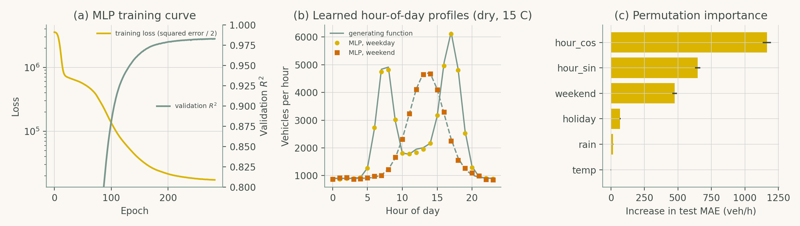
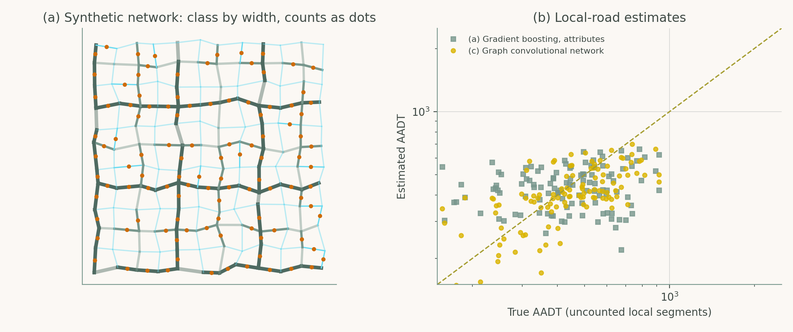

# Chapter 2: AI Core Concepts and Methodologies

Companion code for Chapter 2 of *Artificial Intelligence in Highway Engineering*. Each script is the concatenation, in book order, of that case study's listings from `chapters/02a.tex`, so it runs top to bottom without edits.

| Script | Case study | Libraries |
|---|---|---|
| [`cs1_mlp_traffic_volume.py`](cs1_mlp_traffic_volume.py) | Case Study 1: A neural network for hourly traffic volume | scikit-learn, pandas, matplotlib |
| [`cs2_gnn_local_volume.py`](cs2_gnn_local_volume.py) | Case Study 2: A graph neural network for volume on uncounted local roads | TensorFlow/Keras, networkx, scikit-learn |

## Case Study 1: A neural network for hourly traffic volume

Predict hourly volume from calendar and weather covariates with a multilayer perceptron; compare it with a seasonal-naive baseline, a linear model with interactions, and gradient boosting; inspect what the network learned (permutation importance).



## Case Study 2: A graph neural network for volume on uncounted local roads

Estimate AADT on uncounted segments of a synthetic road network from segment attributes and network structure; compare a class-median lookup, gradient boosting, and a Keras graph convolutional network (GCN) trained on counted segments only.



## Run

```bash
python scripts/run_all.py --chapter 2      # from the repository root
```

Outputs (figures, CSV/JSON) are written to `outputs/ch02/`.
