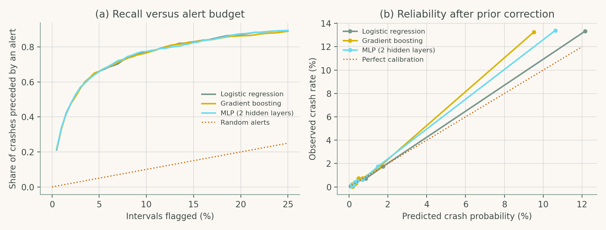

# Chapter 3: AI for Traffic Flow, Congestion, and Road Safety

Companion code for Chapter 3 of *Artificial Intelligence in Highway Engineering*. Each script is the concatenation, in book order, of that case study's listings from `chapters/03a.tex`, so it runs top to bottom without edits.

| Script | Case study | Libraries |
|---|---|---|
| [`cs1_volume_forecasting.py`](cs1_volume_forecasting.py) | Case Study 1: Short-term traffic volume forecasting | statsmodels, TensorFlow/Keras, scikit-learn |
| [`cs2_crash_risk_classification.py`](cs2_crash_risk_classification.py) | Case Study 2: Real-time crash risk classification | TensorFlow/Keras, scikit-learn |

## Case Study 1: Short-term traffic volume forecasting

Forecast hourly volume 1 h and 24 h ahead; compare seasonal-naive, SARIMA, gradient boosting with calendar/weather features, and an LSTM, with errors reported overall and on holidays. Also writes `synthetic_hourly_volume.csv`.


## Case Study 2: Real-time crash risk classification

Estimate the probability of a crash in a 5-minute freeway interval; compare logistic regression, gradient boosting and a neural network; set the alert threshold from an operational alert budget.



## Run

```bash
python scripts/run_all.py --chapter 3      # from the repository root
```

Outputs (figures, CSV/JSON) are written to `outputs/ch03/`.
