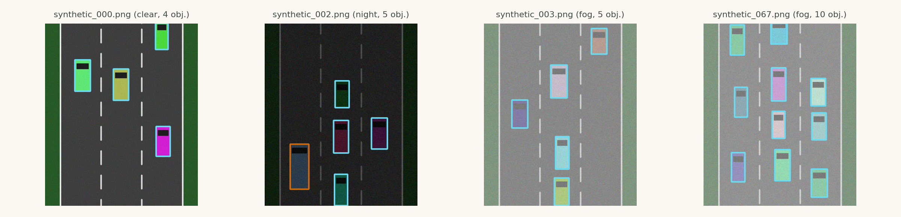
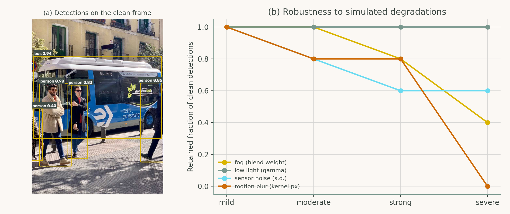

# Chapter 4: AI for Connected and Automated Vehicles

Companion code for Chapter 4 of *Artificial Intelligence in Highway Engineering*. Each script is the concatenation, in book order, of that case study's listings from `chapters/04a.tex`, so it runs top to bottom without edits.

| Script | Case study | Libraries |
|---|---|---|
| [`cs1_synthetic_perception_dataset.py`](cs1_synthetic_perception_dataset.py) | Case Study 1: A synthetic, automatically labeled perception dataset | OpenCV, NumPy, matplotlib |
| [`cs2_onnx_detector_robustness.py`](cs2_onnx_detector_robustness.py) | Case Study 2: Edge object detection and robustness testing | ONNX Runtime, OpenCV, matplotlib |

## Case Study 1: A synthetic, automatically labeled perception dataset

Generate 200 top-down road scenes with controlled vehicle class, density, truncation and visibility; export YOLO and JSON labels; audit the labels programmatically. Writes `synthetic_*.png/.txt` and `annotations.json`.



## Case Study 2: Edge object detection and robustness testing

Run a pretrained YOLO11n ONNX detector on CPU, implement letterbox pre-/post-processing with NMS, and measure how detections change under fog, low light, sensor noise and motion blur. **Needs `yolo11n.onnx` and `traffic_scene.jpg`: run `python scripts/fetch_assets.py` first.**



## Run

```bash
python scripts/run_all.py --chapter 4      # from the repository root
```

Outputs (figures, CSV/JSON) are written to `outputs/ch04/`.
