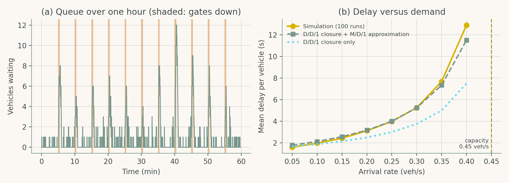
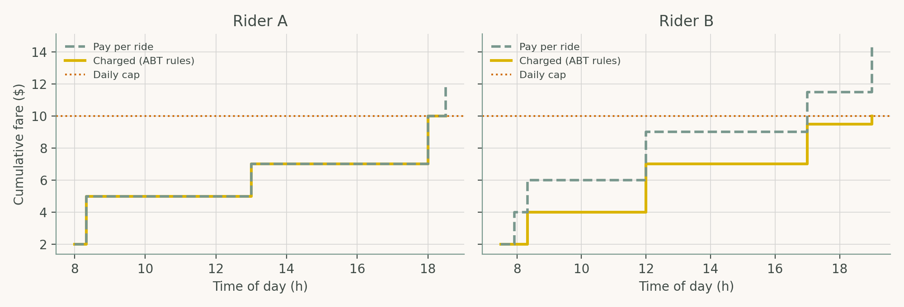

# Chapter 5: AI in Public Transportation and Mobility Services

Companion code for Chapter 5 of *Artificial Intelligence in Highway Engineering*. Each script is the concatenation, in book order, of that case study's listings from `chapters/05a.tex`, so it runs top to bottom without edits.

| Script | Case study | Libraries |
|---|---|---|
| [`cs1_grade_crossing_simulation.py`](cs1_grade_crossing_simulation.py) | Case Study 1: Discrete-event simulation of a grade crossing | NumPy, heapq, matplotlib |
| [`cs2_fare_engine.py`](cs2_fare_engine.py) | Case Study 2: An account-based fare engine prototype | dataclasses, matplotlib |

## Case Study 1: Discrete-event simulation of a grade crossing

Estimate road-user delay at a single-lane approach to a highway-rail grade crossing; compare an event-queue (heapq) discrete-event simulation with D/D/1 and M/D/1 analytical approximations and show how delay grows as demand approaches capacity.



## Case Study 2: An account-based fare engine prototype

Implement the back-office pricing logic of an account-based ticketing system for one rider-day, verify it against hand-computed results, and compare the amount charged with pay-per-ride fares.



## Run

```bash
python scripts/run_all.py --chapter 5      # from the repository root
```

Outputs (figures, CSV/JSON) are written to `outputs/ch05/`.
