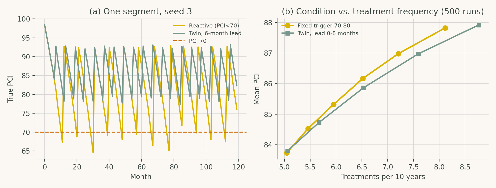

# Chapter 6: AI for Transportation Infrastructure Management

Companion code for Chapter 6 of *Artificial Intelligence in Highway Engineering*. Each script is the concatenation, in book order, of that case study's listings from `chapters/06a.tex`, so it runs top to bottom without edits.

| Script | Case study | Libraries |
|---|---|---|
| [`cs1_pavement_screening.py`](cs1_pavement_screening.py) | Case Study 1: Pavement deterioration and treatment screening | scikit-learn, pandas, matplotlib |
| [`cs2_pavement_digital_twin.py`](cs2_pavement_digital_twin.py) | Case Study 2: Maintenance-trigger policies in a pavement digital twin | NumPy, pandas, matplotlib |

## Case Study 1: Pavement deterioration and treatment screening

Simulate a 1,000-segment inventory, fit baseline / linear / ensemble models for one-year PCI change, rank features by permutation importance, and screen held-out segments for maintenance.


## Case Study 2: Maintenance-trigger policies in a pavement digital twin

Simulate pavement condition over time and compare fixed-threshold maintenance triggers with a twin-lead policy via a parameter sweep of treatment rate, mean PCI, share below 70 and cost.



## Run

```bash
python scripts/run_all.py --chapter 6      # from the repository root
```

Outputs (figures, CSV/JSON) are written to `outputs/ch06/`.
