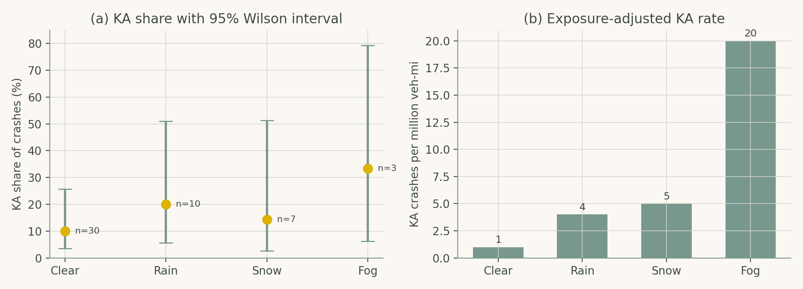
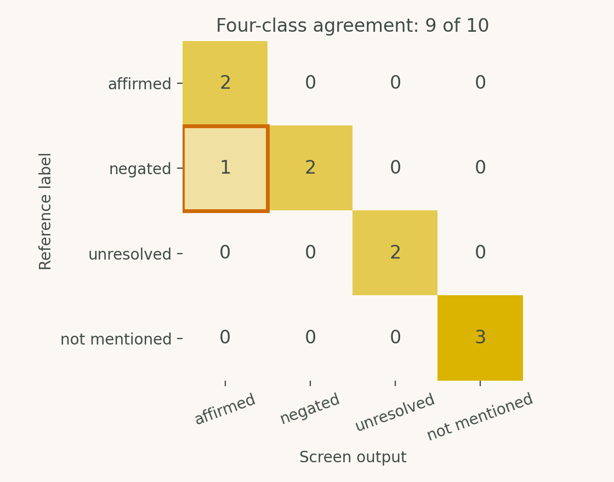

# Chapter 7: AI-Powered Data Analytics and Decision Support

Companion code for Chapter 7 of *Artificial Intelligence in Highway Engineering*. Each script is the concatenation, in book order, of that case study's listings from `chapters/07a.tex`, so it runs top to bottom without edits.

| Script | Case study | Libraries |
|---|---|---|
| [`cs1_exposure_adjusted_crashes.py`](cs1_exposure_adjusted_crashes.py) | Case Study 1: Exposure-adjusted crash analysis | pandas, NumPy, matplotlib |
| [`cs2_crash_narrative_screening.py`](cs2_crash_narrative_screening.py) | Case Study 2: Evidence screening in crash narratives | re, matplotlib |

## Case Study 1: Exposure-adjusted crash analysis

From record-level synthetic crashes (KABCO severity), compute conditional severity proportions, exposure-adjusted rates and Wilson intervals by weather condition.



## Case Study 2: Evidence screening in crash narratives

Distinguish a documented assertion from the mere presence of a word in ten invented narratives (affirmed / negated / unresolved / not mentioned) and report precision, recall and agreement.



## Run

```bash
python scripts/run_all.py --chapter 7      # from the repository root
```

Outputs (figures, CSV/JSON) are written to `outputs/ch07/`.
