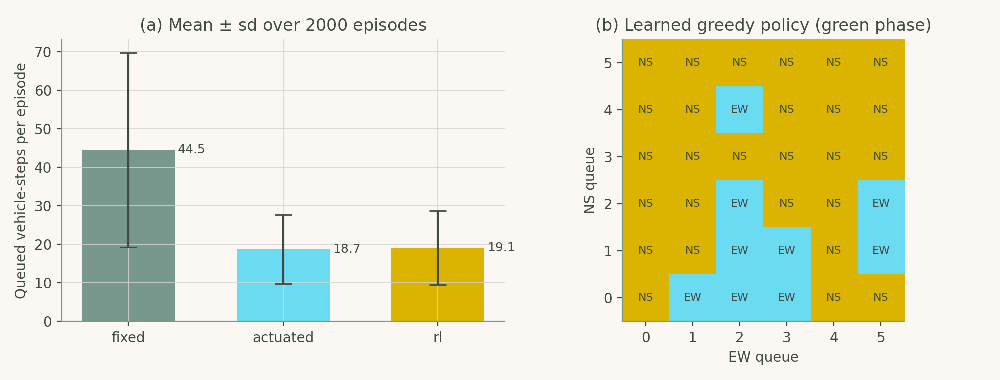
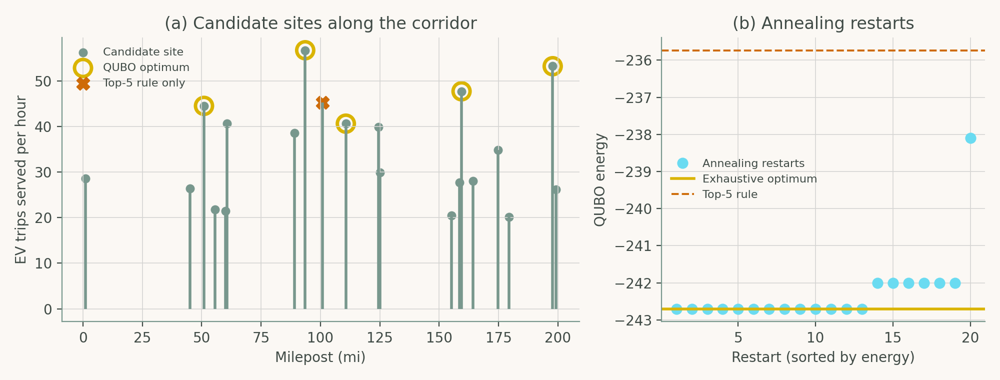

# Chapter 8: Emerging AI Models and Future Horizons in Highway Engineering

Companion code for Chapter 8 of *Artificial Intelligence in Highway Engineering*. Each script is the concatenation, in book order, of that case study's listings from `chapters/08a.tex`, so it runs top to bottom without edits.

| Script | Case study | Libraries |
|---|---|---|
| [`cs1_q_learning_signal_control.py`](cs1_q_learning_signal_control.py) | Case Study 1: Learning a signal control policy from experience | NumPy, matplotlib |
| [`cs2_charger_qubo.py`](cs2_charger_qubo.py) | Case Study 2: Formulating charger siting as a QUBO | NumPy, itertools, matplotlib |

## Case Study 1: Learning a signal control policy from experience

Train a tabular Q-learning controller for a two-phase intersection and compare it with a fixed-time (strict alternation) and an actuated (serve the longer queue) baseline over repeated episodes.



## Case Study 2: Formulating charger siting as a QUBO

Cast EV-charger siting as a QUBO, solve it by exhaustive search and simulated annealing, and compare both with a top-demand rule.



## Run

```bash
python scripts/run_all.py --chapter 8      # from the repository root
```

Outputs (figures, CSV/JSON) are written to `outputs/ch08/`.
